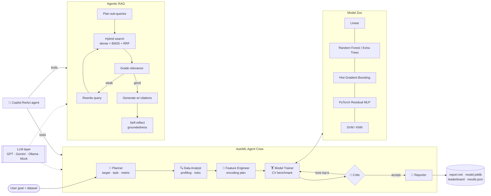
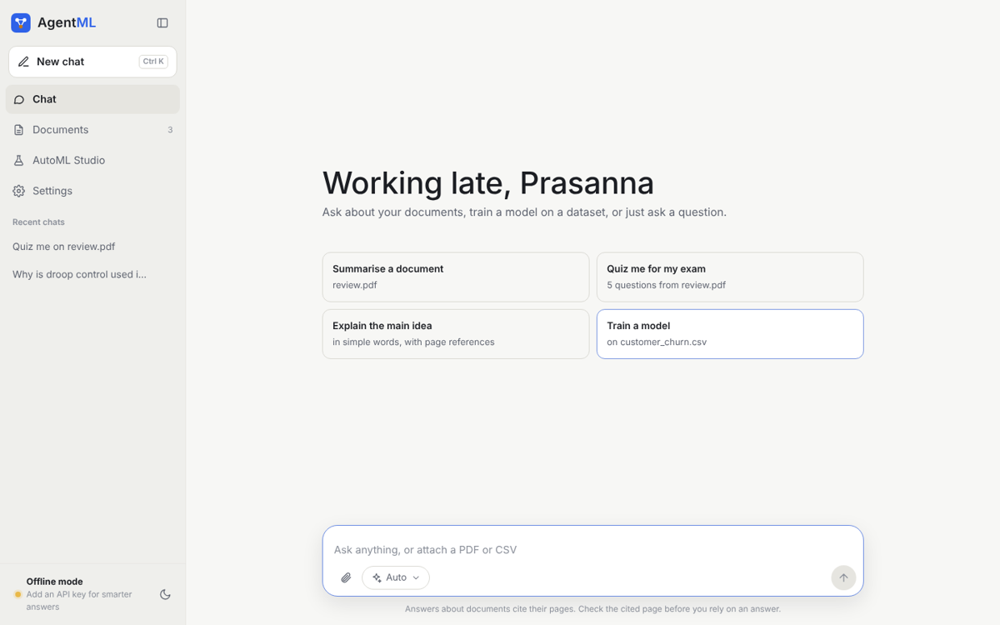
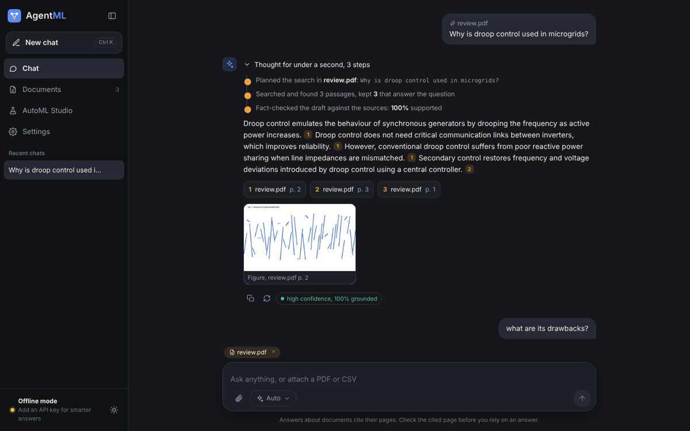
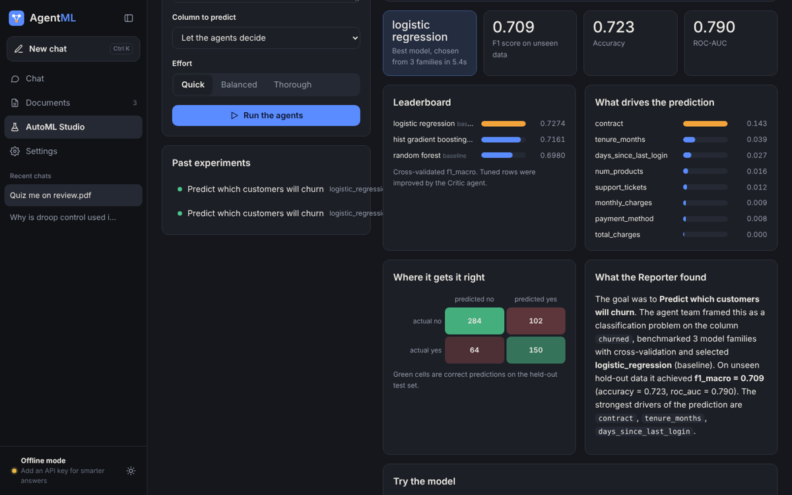
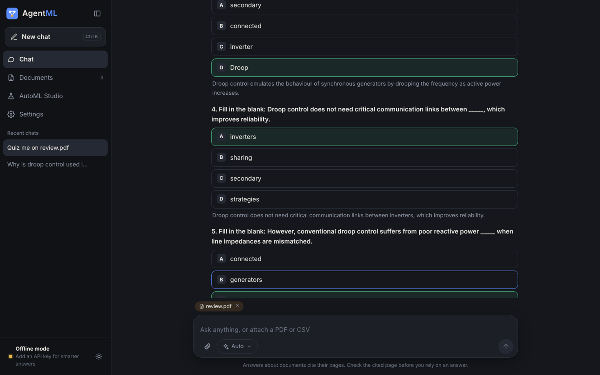

<div align="center">

# 🤖 AgentML Studio

### Autonomous Multi-Agent AutoML + Agentic RAG, powered by LLMs

**Give it a dataset and a goal in plain English. A team of AI agents plans the project, audits the data, engineers features, trains classical ML, gradient-boosting and deep-learning models, critiques and tunes them, then writes the report.**


</div>

---

## ✨ Highlights

| | Feature | What it does |
|---|---|---|
| 🧠 | **Multi-agent AutoML crew** | Six specialised agents (Planner → Data Analyst → Feature Engineer → Model Trainer → Critic → Reporter) collaborate on every run |
| 🔁 | **Self-improving loop** | The Critic agent reviews the leaderboard, decides which models deserve hyper-parameter tuning, and flags over-fitting by comparing CV against held-out scores |
| 🔥 | **Deep learning for tabular data** | A PyTorch **residual MLP** (LayerNorm, GELU, dropout, AdamW, cosine LR, label smoothing, class weights, early stopping) competes against classical ML |
| 📚 | **Agentic RAG** | Query planning → **hybrid search (dense + BM25 with reciprocal-rank fusion)** → relevance grading → query rewriting → cited generation → **self-reflection / groundedness check** |
| 🛠️ | **Native tool calling** | `@tool` turns any Python function into a JSON-schema tool usable by GPT, Gemini and Llama. The ReAct loop has a step budget and recovers from tool errors |
| 📕 | **Docs Chat (chat with PDFs)** | Upload PDFs and ask follow-up questions in a chat. Answers cite **page numbers**, show the **figures from the cited pages**, open the PDF at the right page, and can be scoped to selected documents |
| 🎓 | **Study tools** | One-click **summary** and auto-generated **MCQ quiz** (with scoring and explanations) for any document, which is handy for exam revision |
| ⚙️ | **In-app settings** | Pick GPT / Gemini / Ollama and paste an API key in the UI. It is tested live, saved only to your local `.env`, and hot-swapped without a restart |
| 💬 | **Data-Science Copilot** | A conversational agent that can profile datasets, train models, search your documents and do maths |
| 🧩 | **4 LLM backends, 0 SDKs** | OpenAI (and any OpenAI-compatible API such as Groq or Together), Google Gemini, local **Ollama**, plus an offline **mock** mode, all through raw `httpx` with retries and token accounting |
| 🛡️ | **Hallucination-safe decisions** | Every LLM decision is seeded with an analytic baseline, parsed robustly and **validated** before use, so bad JSON or invented columns can't break a run or leak the target |
| 🧠 | **Memory** | A sliding-window short-term memory plus a persistent long-term memory with semantic recall. Agents remember past experiments |
| 🖥️ | **Chat-style web app** | Sidebar with saved chats, dark and light themes, a composer that takes attached PDFs and CSVs, a live "thinking" trail, typewriter answers, keyboard shortcuts and a mobile layout. No build step and no internet needed |
| 🎨 | **Image generation** | Ask in plain English or Hinglish ("ek robot ki image banao"). A chat model first rewrites the request into a detailed prompt, then OpenAI's image model (gpt-image-1, with a dall-e-3 fallback) draws it. Images are saved locally and can be downloaded |
| 🔮 | **Prediction playground** | After training, a form is built from the dataset's columns so you can try the model on new values |
| 🌐 | **REST API + CLI** | Every feature is also available over FastAPI (documented at `/docs`) and through the `agentml` command |
| ✅ | **Production hygiene** | 46 tests (all of them run offline), GitHub Actions CI on Python 3.10–3.12, Ruff, Docker and docker-compose |

---

## 🏗️ Architecture



**How decisions are made.** Each agent first runs deterministic analysis (profiling, heuristics) to produce a *baseline decision*. The LLM sees the evidence and the baseline and may keep or improve it. The reply is then parsed, filtered to allowed keys, and sanitised (for example: does the column exist? is it the target? is the metric valid for the task?). You get LLM judgement with ML-grade reproducibility.

---

## 📸 Screenshots

| Home (light theme) | Chat with your PDFs: thinking trail, page citations, figures |
|---|---|
|  |  |
| **AutoML Studio: agent crew, leaderboard, drivers, confusion matrix** | **Exam quiz generated from a paper** |
|  |  |

---

## 🚀 Quick start

```bash
git clone https://github.com/prasanna6110/agentml-studio.git
cd agentml-studio
python -m venv .venv && source .venv/bin/activate      # Windows: .venv\Scripts\activate
pip install torch --index-url https://download.pytorch.org/whl/cpu
pip install -e ".[dev]"
python examples/generate_datasets.py                   # creates the demo datasets
```

### Add your LLM key (optional)

```bash
cp .env.example .env        # Windows: copy .env.example .env
```

Put **one** key in `.env`, for example `OPENAI_API_KEY=...` or `GEMINI_API_KEY=...` (or simply paste it in the app's Settings page). `.env` is git-ignored, so never commit it.
Without a key everything still runs in **mock mode**. That mode is a deterministic rule-based policy that drives the same agent protocol, so the full pipeline, the tests and the UI all work offline.

### Run it

```bash
agentml serve                      # web UI → http://127.0.0.1:8000   (API docs at /docs)
agentml demo                       # 60-second end-to-end demo in the terminal
agentml automl examples/data/customer_churn.csv --goal "Predict which customers will churn"
agentml automl examples/data/house_prices.csv --goal "Estimate the house price" --budget high
agentml rag ingest examples/knowledge
agentml rag ask "How does agentic RAG differ from normal RAG?"
agentml chat                       # interactive copilot
agentml --provider ollama --model llama3.1 chat   # fully local LLM
```

### Docker

```bash
docker compose up --build          # → http://localhost:8000
```

---

## 🐍 Python API

```python
from agentml import AutoMLPipeline, AgenticRAG, get_llm

llm = get_llm()                                   # provider picked from .env (or "mock")

result = AutoMLPipeline(llm).run(
    "examples/data/customer_churn.csv",
    goal="Predict which customers will churn",
    budget="medium",                              # low | medium | high
)
print(result.summary())                           # best model, CV and test score
print(result.feature_importance[:5])
print(result.report_markdown)

from agentml.pipeline import predict
predict(result.run_dir, [{"contract": "month-to-month", "tenure_months": 2, "monthly_charges": 95}])

rag = AgenticRAG(llm)
rag.ingest_path("examples/knowledge")
ans = rag.query("Why is accuracy misleading on imbalanced data?")
print(ans.answer, ans.confidence, ans.citations)
```

Build your own tool-using agent:

```python
from agentml.agents import Agent
from agentml.tools import ToolRegistry, tool

@tool
def get_weather(city: str) -> str:
    """Get the weather for a city.

    Args:
        city: City name.
    """
    return f"Sunny in {city}"

agent = Agent("Helper", "a helpful assistant", get_llm(), tools=ToolRegistry([get_weather]))
print(agent.run("What's the weather in Kurukshetra?").answer)
```

---

## 📊 Example results (mock mode, `budget=medium`)

| Dataset | Task | Best model | CV | Held-out test |
|---|---|---|---|---|
| `customer_churn.csv` (3,000 × 15) | classification | logistic regression (tuned) | F1-macro 0.729 | F1-macro 0.708 · ROC-AUC 0.788 |
| `house_prices.csv` (2,000 × 10) | regression | random forest | R² 0.897 | R² 0.874 |

The crew found the real drivers that were planted in the synthetic data: contract type, tenure and days since last login for churn, and area, city and property age for price. It also dropped the ID columns on its own.

---

## 🗂️ Project structure

```
agentml/
├── llm/            # provider-agnostic LLM layer: OpenAI, Gemini, Ollama, Mock
├── tools/          # @tool decorator → JSON schema, registry, built-in tools
├── agents/         # ReAct Agent, structured decisions, short/long-term memory
├── ml/             # profiling, feature engineering, model zoo, PyTorch ResNet, evaluation
├── rag/            # chunking, embeddings, hybrid vector store (BM25 + dense + RRF), agentic RAG
├── pipeline.py     # the 6-agent AutoML orchestration + self-improvement loop
├── copilot.py      # conversational data-science agent
├── reporting.py    # markdown experiment reports
├── server/         # FastAPI app + single-page web UI
└── cli.py          # `agentml` command
examples/           # demo datasets generator + knowledge-base docs
tests/              # 46 offline tests (providers tested with mocked HTTP)
```

---

## 🧪 Testing

```bash
pytest          # 46 tests, ~1 min, no network / API key needed
ruff check .
```

The tests cover tool-schema generation, the multi-step ReAct loop, and provider wire formats for GPT and Gemini (using `httpx.MockTransport`). They also check that deep models really learn, that a **"chaos" LLM returning garbage cannot corrupt a run**, that RAG answers carry citations and refuse out-of-scope questions, and the full REST API flow.

---

## 🛣️ Roadmap

- [ ] Streaming LLM tokens to the UI (SSE)
- [ ] Optuna / Bayesian hyper-parameter search
- [ ] Time-series forecasting agent
- [ ] SHAP explanations
- [ ] MCP server exposing the tools to other agents

## 👤 Author

**Prasanna Kumar Pandey**, NIT Kurukshetra

## 📄 License

[MIT](LICENSE)
